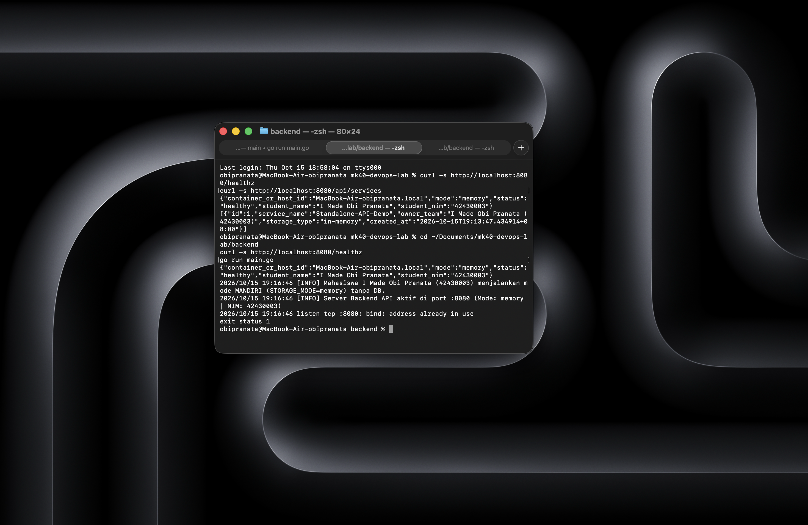
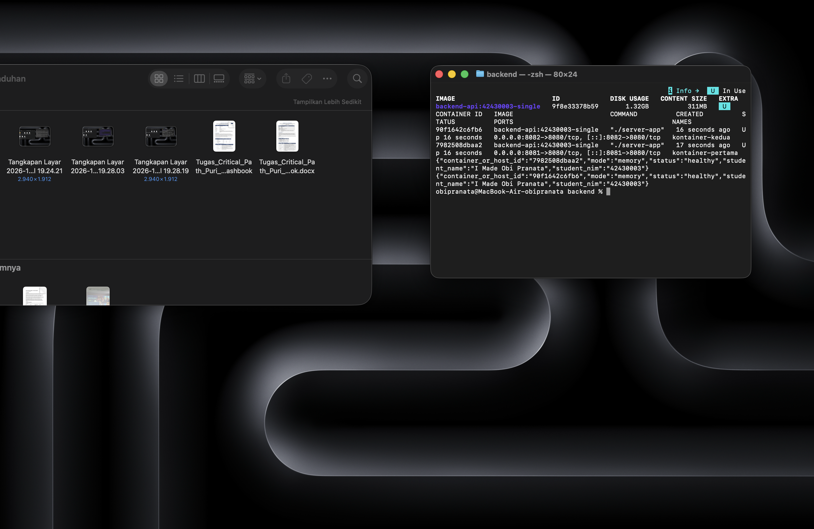
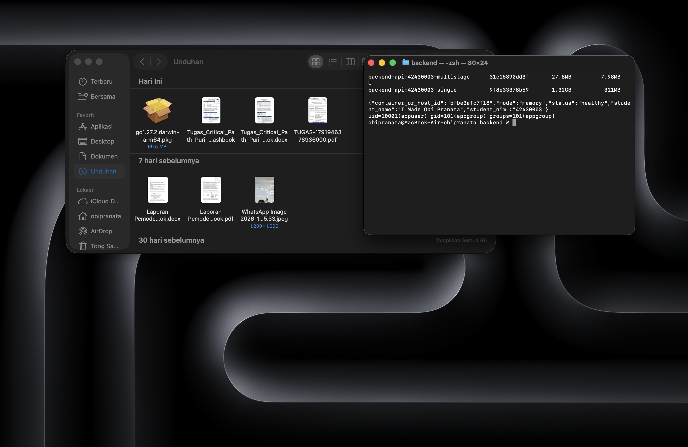
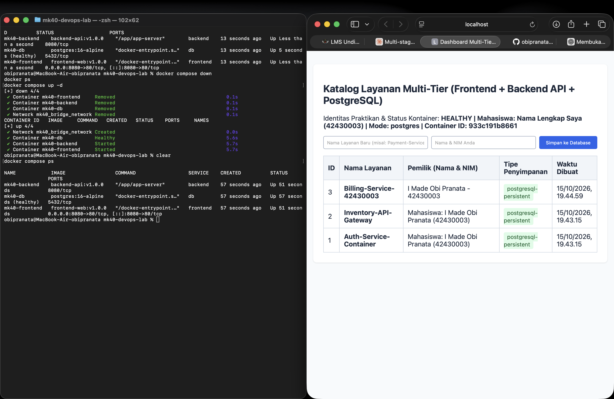
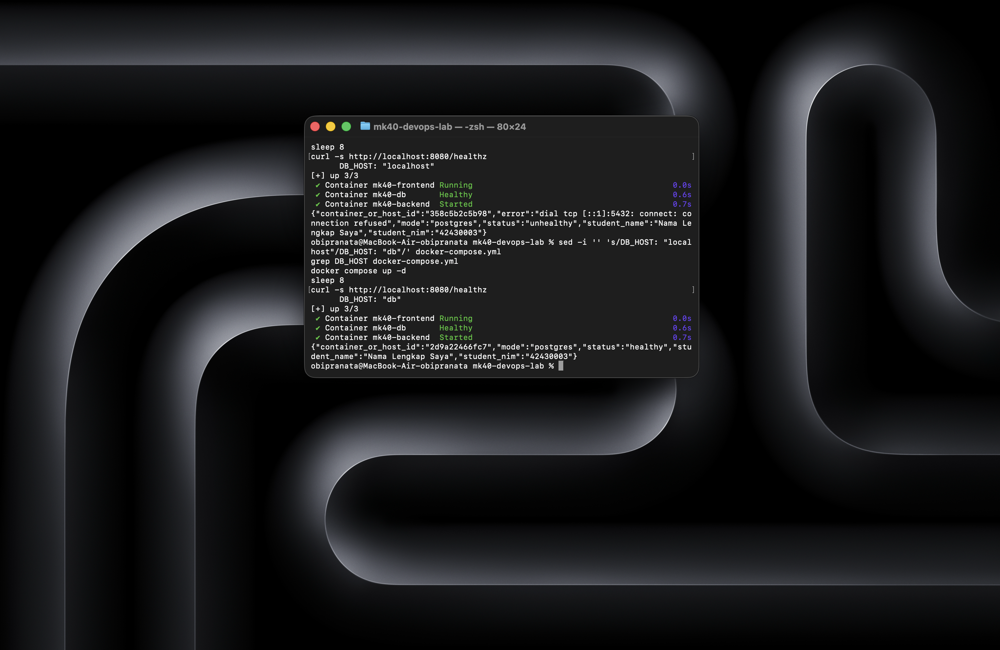
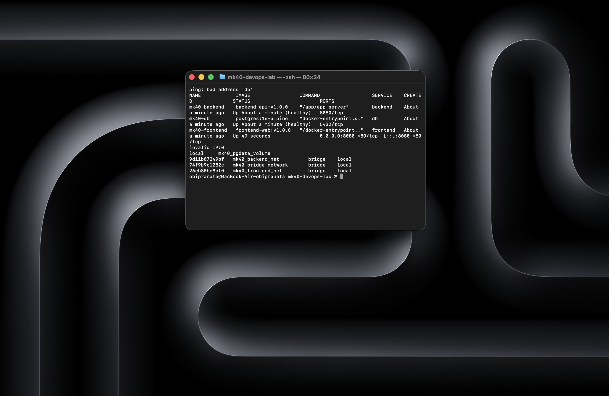

# Laporan Praktikum Modul 1 (Pertemuan 4): Kontainerisasi Docker & Orkestrasi Multi-Tier (Lab 1 & Lab 2)

- **Nama Mahasiswa**: I Made Obi Pranata
- **NIM**: 42430003
- **Kelas / Prodi**: S1 Teknologi Informasi – UNDIKNAS Denpasar
- **Tautan Branch / Pull Request GitHub**: https://github.com/obipranata2006/mk40-devops-lab/pull/NOMOR_PR
- **Nama Rekan Peer-Reviewer**: NAMA_REVIEWER

---

## 1. Tabel Komparasi Eksperimen

| Parameter | Tahap 1: Tanpa Docker | Tahap 2: Single-Stage | Tahap 3: Multi-Stage |
| :--- | :--- | :--- | :--- |
| Kebutuhan Go di Host | Wajib | Tidak wajib | Tidak wajib |
| Ukuran Image | Tidak ada image | 1.32GB | 27.8MB (lulus < 100 MB) |
| container_or_host_id & NIM | Hostname: HOSTNAME_MAC / NIM: 42430003 | ID: ID_SC02 / NIM: 42430003 | ID: bfbe3afc7f18 / NIM: 42430003 |
| User proses (`id`) | User Mac | root (uid=0) | uid=10001 (appuser) |
| 2 instansi sekaligus | Gagal (port sama) | Berhasil (8081 & 8082) | Berhasil |

Penghematan ukuran image: (1320 MB − 27.8 MB) ÷ 1320 MB × 100% ≈ **97,9%**.

---

## 2. Bukti Screenshot & Analisis

### A. Tahap 1 – Tanpa Docker

**Analisis:** Pada tahap ini aplikasi dijalankan dengan `go run main.go` langsung di macOS, tanpa Docker. Karena itu nilai `container_or_host_id` berisi hostname Mac saya (HOSTNAME_MAC), bukan ID kontainer: proses berjalan di sistem operasi host. Aplikasi juga hanya bisa berjalan karena compiler Go sudah saya pasang di Mac. Saat `go run main.go` dijalankan kedua kali, instans kedua gagal dengan `bind: address already in use`. Sebuah port (8080) hanya bisa dipakai satu proses pada satu sistem operasi, dan instans pertama sudah memakainya. Ini contoh konflik port tanpa isolasi.

### B. Tahap 2 – Single-Stage

**Analisis:** Dari satu image `backend-api:42430003-single` saya menjalankan dua kontainer sekaligus. Keduanya tidak bentrok karena setiap kontainer punya network namespace sendiri, sehingga port 8080 di dalam masing-masing kontainer terpisah. Port di Mac saya beda-bedakan lewat pemetaan `-p 8081:8080` dan `-p 8082:8080`. Nilai `container_or_host_id` kini berupa ID kontainer yang berbeda untuk tiap kontainer. Ukuran image mencapai 1.32GB karena memakai base image `golang:1.22-bookworm` yang membawa compiler Go, source code, dan paket sistem, padahal untuk menjalankan aplikasi hanya dibutuhkan file binernya.

### C. Tahap 3 – Multi-Stage

**Analisis:** Image multi-stage hanya 27.8MB dibanding 1.32GB pada single-stage, penghematan sekitar 97,9%. Instruksi `COPY --from=builder` hanya menyalin file biner hasil kompilasi dari stage builder ke stage production (alpine), sehingga compiler dan source code tertinggal di stage builder dan tidak ikut ke image akhir. Pada stage builder, `go.mod` dan `go.sum` disalin lebih dulu lalu `go mod download` dijalankan, sehingga layer dependensi ter-cache dan tidak diunduh ulang bila hanya `main.go` yang berubah. Aplikasi dijalankan dengan `USER appuser` (uid 10001), terbukti dari output `id`, agar proses tidak berjalan sebagai root. Jika aplikasi diretas, hak akses penyerang di dalam kontainer lebih terbatas.

### D. Tahap 4 – Docker Compose & Persistensi

**Analisis:** Alur permintaan: browser mengakses frontend (Nginx) di `localhost:8080`; Nginx meneruskan permintaan `/api/` dan `/healthz` ke kontainer `backend` lewat nama layanan; backend terhubung ke PostgreSQL dengan `DB_HOST=db`, yang diterjemahkan oleh DNS internal Docker pada jaringan bridge. Layanan `db` tidak memiliki bagian `ports:`, sehingga port 5432 tidak terbuka ke host. Data disimpan di named volume `pgdata` (`mk40_pgdata_volume`) yang berada di luar siklus hidup kontainer. Setelah `docker compose down` lalu `docker compose up -d`, Container ID berubah, tetapi data `Billing-Service-42430003` tetap ada karena volume tidak ikut terhapus.

### E. Tahap 5 – Troubleshooting

**Analisis:** Saat `DB_HOST` saya ubah menjadi `localhost`, `/healthz` menjadi `unhealthy` dengan error `dial tcp [::1]:5432: connect: connection refused`. Di dalam kontainer backend, `localhost` merujuk ke kontainer backend itu sendiri, bukan ke kontainer `db`, dan di sana tidak ada PostgreSQL yang mendengarkan port 5432. Setelah dikembalikan ke `DB_HOST: "db"`, status kembali `healthy`. Perintah `docker compose down -v` berbahaya karena flag `-v` ikut menghapus named volume, sehingga seluruh data PostgreSQL hilang permanen.

### F. Tantangan Mandiri

**Analisis:** Saya memisahkan jaringan menjadi `frontend-net` dan `backend-net`. Frontend hanya terhubung ke `frontend-net`, db hanya ke `backend-net`, dan backend ke keduanya sebagai perantara. Akibatnya `docker exec mk40-frontend ping -c 2 db` gagal (`bad address 'db'`) karena frontend tidak berada di jaringan yang sama dengan db, sementara aplikasi web tetap berjalan lewat backend. `docker compose port db 5432` kosong, bukti port database tidak terbuka ke publik. Kredensial dipindahkan ke file `.env` yang dimasukkan ke `.gitignore`, sehingga password tidak ikut ke GitHub; yang diunggah hanya `.env.example` berisi contoh tanpa password asli. Healthcheck backend dan `depends_on` dengan `condition: service_healthy` memastikan urutan start: db sehat, lalu backend sehat, baru frontend.

---

## 3. Bukti Audit Silang (Peer-Review)
- **Tautan Pull Request (PR saya)**: https://github.com/obipranata2006/mk40-devops-lab/pull/NOMOR_PR
- **Ringkasan Catatan Peer-Reviewer**: CATATAN_REVIEWER
- **PR teman yang saya review**: LINK_PR_TEMAN
